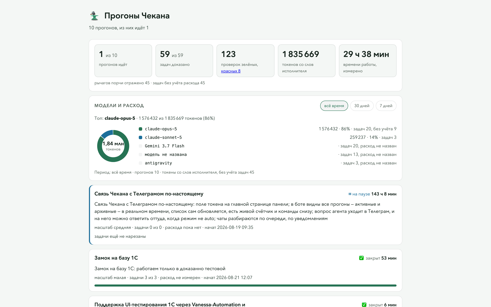

# Чекан

Команда агентов для Claude Code, которая доводит задачу до готового результата.

Вы пишете задачу обычными словами: «чекан, найди должников и подготовь им письма». Бригадир (главный агент) задаёт вопросы кнопками, собирает команду из ролей-профи и раздаёт им работу. Проверяющий сверяет каждый результат с чек-листом. Работа сдаётся, только когда вы ответите «принимаю».

- **Режимы.** «Автомат» — без вопросов. «Вопросы» — Бригадир уточняет главное на старте. «Контроль» — ещё и спрашивает «да» перед планом и перед работой.
- **41 роль в 11 направлениях:** продажи, закупки, финансы, право, маркетинг, клиенты, персонал, управление, разработка, документы. Список: `chekan roles`.
- **Кабинет** на http://localhost:8789: команда бурундуков за столами, вопросы с кнопками, чат с Бригадиром, результаты и расход.
- **Папка проекта** `~/Чекан/<раздел>/`: результаты в «Готово», памятка «ЧЕКАН.md». Вернуться к работе: «чекан, продолжай».
- **Экономно.** Дорогие модели выключены, пока вы их не разрешите.



## Установка

Нужны Claude Code и Python 3.9–3.14.

```bash
claude plugin marketplace add CodoCeh/chekan
claude plugin install chekan@codoceh --scope user -y
```

В сессии Claude Code то же самое: `/plugin marketplace add CodoCeh/chekan` и `/plugin install chekan@codoceh`. Новая сессия сама найдёт команду `chekan`.

Команда `chekan` в обычном терминале и раскладка для других агентов (Codex, Antigravity, opencode):

```bash
git clone https://github.com/CodoCeh/chekan ~/.chekan-app
python3 ~/.chekan-app/install.py
```

Проверить: `chekan doctor`. Обновить: `claude plugin update chekan@codoceh`.

## Начать

Откройте Claude Code в любой папке и напишите: «чекан, …» и задачу.

Исходный код Чекана закрыт, здесь лежит готовая сборка.

[Выковано в КодоЦех](https://codoceh.ru)
