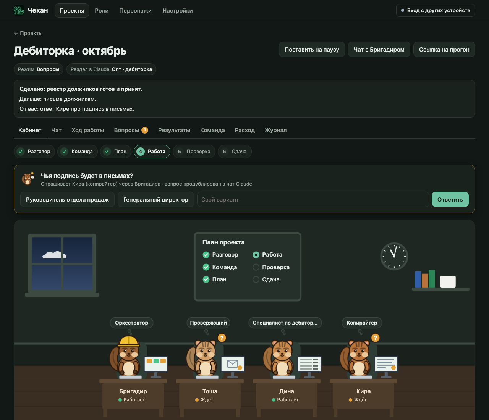
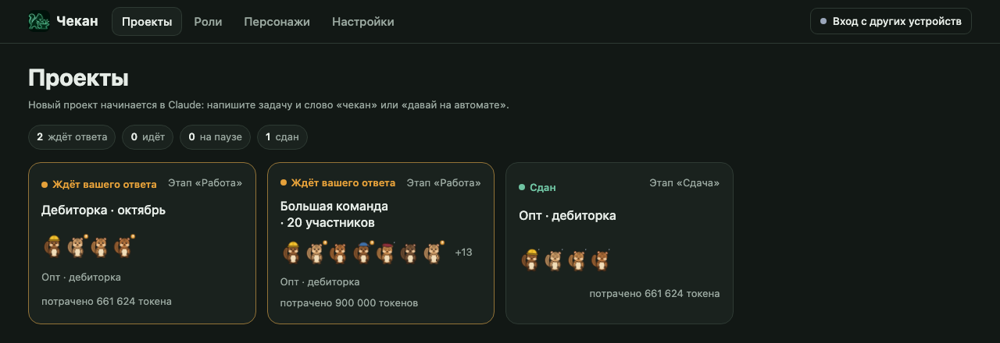

# Чекан

Команда помощников в Claude, которая доводит вашу задачу до готового результата.

Вы пишете задачу обычными словами, например: «чекан, найди должников по выгрузке и подготовь им письма». Дальше работает команда. Бригадир, главный помощник, уточняет задачу и собирает команду из профи: копирайтера, юриста, аналитика и других. Он раздаёт им работу, а проверяющий сверяет каждый результат с чек-листом. Работа считается сданной только после вашего «принимаю».

Всё это видно в кабинете: команда бурундуков сидит за столами, и сразу понятно, кто работает, кто ждёт вашего ответа и что уже готово.



## Как это работает

1. **Разговор.** Бригадир задаёт несколько вопросов кнопками: что должно получиться, кого взять в команду, можно ли тратить дорогие модели, как назвать проект, присылать ли вопросы в Gmail и Google Drive.
2. **Команда.** Бригадир подбирает роли под задачу. Всего их 48, по 11 направлениям: продажи, закупки, финансы, право, маркетинг, клиенты, персонал, управление, разработка, документы. У каждой роли свои правила и свои инструменты. Для разработки есть техлид, системный аналитик, программисты (бэкенд, фронтенд, мобильные, 1С), аналитик 1С, ревьюер кода и тестировщик: состав зависит от размера задачи.
3. **План.** Задача делится на части, и у каждой части появляется чек-лист: по нему потом проверят результат.
4. **Работа.** Участники делают свои части. Если кому-то не хватает сведений, вопрос приходит вам в Claude и в кабинет.
5. **Проверка.** Проверяющий сверяет результат с чек-листом. Ставит «принято» или возвращает работу на доработку и объясняет причину.
6. **Сдача.** Бригадир показывает результат. Вы отвечаете «принимаю» или говорите, что поправить.

Результаты складываются в папку проекта `~/Чекан/<название проекта>/Готово`. Черновики удаляются после сдачи, лишних файлов не остаётся.

## Установка

Нужны Claude Code и Python 3.9–3.14. На Mac Python уже есть.

В терминале:

```bash
claude plugin marketplace add CodoCeh/chekan
claude plugin install chekan@codoceh --scope user -y
```

Или прямо в сессии Claude Code: `/plugin marketplace add CodoCeh/chekan`, затем `/plugin install chekan@codoceh`.

После установки откройте новую сессию Claude Code. Проверить, что всё на месте, можно командой `chekan doctor`.

## Как пользоваться

**Начать.** Откройте Claude Code в любой папке и напишите «чекан» и задачу:

> чекан, сделай коммерческое предложение для оптовых клиентов по прайсу из таблицы

Можно сразу назвать режим работы:

| Режим | Как сказать | Что будет |
|---|---|---|
| Автомат | «чекан, на автомате …» | Вопросов нет. Всё неясное команда запишет в отчёт как предположение. |
| Вопросы | «чекан, позадавай вопросы …» | Несколько вопросов в начале, дальше команда работает сама. Подходит, когда вы рядом. |
| Контроль | «чекан, с подтверждением …» | Как «Вопросы», плюс ваше «да» перед планом и перед работой. |

Режим не назван — Бригадир спросит сам.

**Отвечать на вопросы.** Вопросы приходят кнопками. Выберите вариант или напишите свой. Ответить можно и в Claude, и в кабинете: засчитывается первый ответ.

**Смотреть, как идёт работа.** Кабинет открывается сам по адресу http://localhost:8789. Ярлык на него появляется на рабочем столе. В кабинете есть:
- **Кабинет**: кто чем занят прямо сейчас;
- **Чат**: можно написать Бригадиру, он ответит в своей очереди;
- **Ход работы**: этапы и задачи;
- **Вопросы**: всё, что ждёт вашего ответа;
- **Результаты**: готовые файлы;
- **Команда**: роли и их инструменты;
- **Расход**: сколько потрачено.

После первого запуска кабинет работает всё время, пока включён компьютер, и после окончания проектов тоже. Выключить его или сделать, чтобы он выключался сам после окончания всех проектов, можно в «Настройках», раздел «Панель».

**Принять работу.** Когда всё готово, Бригадир покажет результат. Ответьте «принимаю» или напишите, что поправить.

**Остановиться и вернуться.**
- «поставь на паузу» или «стоп на сегодня»: новые задачи не начинаются, начатые доделывают текущий шаг.
- «чекан, продолжай»: работа идёт дальше с того же места. Так можно продолжить и в новой сессии, и на другом компьютере: всё нужное лежит в папке проекта, памятка — в файле `ЧЕКАН.md`.

**Как дела?** Спросите «как дела?». Бригадир ответит тремя строками: что сделано, что дальше, что нужно от вас.

**Открыть кабинет с телефона или другого компьютера.** Можно смотреть за работой, отвечать на вопросы и писать Бригадиру с любого устройства в вашей домашней сети.

1. На компьютере, где работает Чекан, откройте кабинет и нажмите вверху справа «Вход с других устройств».
2. Задайте пароль не короче 10 знаков и нажмите «Задать».
3. Включите переключатель «Разрешить вход с других устройств». Через несколько секунд ниже появится адрес вида `http://192.168.1.23:8789`. Нажмите «Скопировать».
4. На телефоне или другом компьютере, подключённом к тому же Wi-Fi, откройте этот адрес в браузере и введите пароль.

Если на Mac включён брандмауэр и появится вопрос, разрешить ли входящие подключения для Python, нажмите «Разрешить»: иначе другие устройства до кабинета не достучатся.

Если адрес не появился, посмотрите IP-адрес компьютера в настройках Wi-Fi (обычно начинается с `192.168.`) и откройте `http://<этот адрес>:8789`.

Не дома, например с мобильного интернета, кабинет открывается только через [Tailscale](https://tailscale.com): это бесплатная защищённая сеть между вашими устройствами. Поставьте его на компьютер и телефон, и в кабинете появится второй адрес «Через Tailscale». Без Tailscale пароль в домашней сети передаётся без шифрования, поэтому вне дома пользуйтесь только им.

Безопасность: после пяти неверных паролей вход закрывается на 15 минут. Менять пароль и выключать доступ можно только на компьютере, где работает Чекан. Кнопка «Выйти везде» закрывает все входы.



## Частые вопросы

**Сколько это стоит?** Чекан бесплатный, работа идёт в рамках вашей подписки Claude. Дорогие модели выключены, пока вы сами их не разрешите на старте. Длинная переписка сжимается автоматически, чтобы не тратить лишнее.

**Где мои данные?** Файлы проекта и ход работы хранятся на вашем компьютере, в папке проекта. Сам Чекан их никуда не отправляет. Gmail и Google Drive используются, только если вы выбрали их на старте и они подключены в Claude. Переписка с помощниками идёт через Claude, как в любой его сессии.

**Нужно ли знать программирование?** Нет. Пишите так, как поставили бы задачу сотруднику.

**Работает ли с другими помощниками?** Продолжить проект можно в Codex, Cursor или Antigravity: откройте папку проекта и напишите «чекан, продолжай». Для команды `chekan` в обычном терминале и раскладки по этим агентам:

```bash
git clone https://github.com/CodoCeh/chekan ~/.chekan-app
python3 ~/.chekan-app/install.py
```

**Как обновить?** Команда `chekan update`: она сама скачает новую версию с GitHub и обновит плагин в Claude. Узнать, есть ли новая версия, не обновляя: `chekan update --check`. После обновления откройте новую сессию Claude.

## Команды для терминала

Обычно они не нужны: всё делается словами в Claude. Пригодятся, чтобы проверить состояние.

| Команда | Что делает |
|---|---|
| `chekan doctor` | проверяет установку |
| `chekan status` | коротко: где сейчас проект |
| `chekan progress` | три строки: сделано, дальше, нужно от вас |
| `chekan roles` | список ролей |
| `chekan dash` | открыть кабинет |
| `chekan update` | обновить Чекан до последней версии |

Исходный код Чекана закрыт, здесь лежит готовая сборка. Пользоваться ею можно бесплатно, условия в файле [LICENSE](LICENSE).

[Выковано в КодоЦех](https://codoceh.ru)
